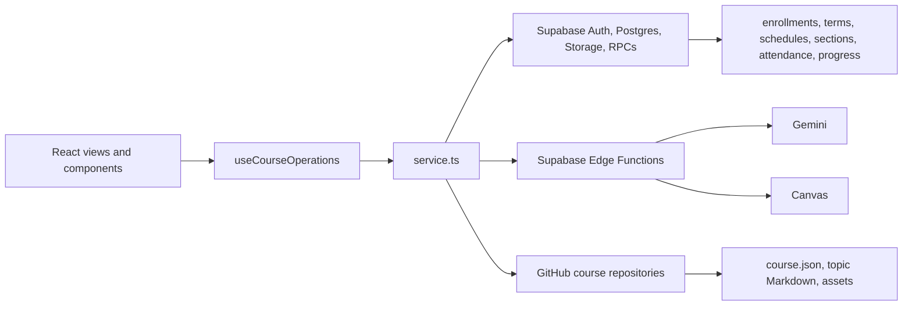

# Architecture

MasteryLS is a browser-based mastery-learning platform. The React client combines course content from GitHub with operational data in Supabase, and calls Supabase Edge Functions for privileged work such as AI requests, Canvas integration, and aggregate reports.

## High-level architecture



- **Frontend:** React 19, React Router 7, Vite 7, Tailwind CSS 4, Monaco, and React Markdown.
- **Operational backend:** Supabase Auth, PostgreSQL, Storage, row-level security, RPCs, and Deno Edge Functions.
- **Course content:** GitHub repositories hold `course.json`, topic Markdown, schedule Markdown, and related assets.
- **AI:** Gemini requests are routed through the `gemini` Edge Function.
- **LMS integration:** Canvas export and gradebook operations use Edge Functions and client-side integration helpers.

The main client layers are **views/components → `useCourseOperations` → `service.ts` → Supabase, Edge Functions, or GitHub**. Components should use the operations hook and service layer rather than making direct database calls.

## Data ownership

| Data | Source of truth | Notes |
| --- | --- | --- |
| Course catalog metadata and roles | Supabase | Catalog rows link a course to its GitHub repository. |
| Modules, topics, and interaction manifests | GitHub `course.json` | The topic table in Supabase is a full-text search index, not the content source. |
| Topic and schedule content | GitHub Markdown/files | Schedule rows point to a Markdown file with `contentPath`. |
| Terms, schedules, sections, and section attendance settings | Supabase | Sections connect enrollments to a schedule and optionally enable attendance. |
| Learner activity history | Supabase `progress` table | Append-only events are the source of history. |
| Enrollment progress summary | Supabase `enrollment.progress` | Cached JSON; displayed mastery and completion are derived from progress and course structure on the client. |
| Attendance sessions and check-ins | Supabase `attendance` and `progress` | A check-in references its session through an attendance progress row. |

New schedule metadata is stored in Supabase. For compatibility, courses without DB schedule rows can still read the legacy `course.json` `schedule.files` entries; new schedule rows and sections take precedence when available. A section points to a schedule, and an enrollment's `sectionId` determines its schedule. A schedule can be used by sections in different terms.

## Core concepts

- **User and role:** users can be learners, mentors, editors, or root administrators. Editors and mentors have course-scoped roles; root is global.
- **Catalog/course:** Supabase stores the course listing and repository reference. GitHub stores authored structure and content.
- **Enrollment:** connects a learner to a course and may identify the learner's section.
- **Term:** a course's instructional period, with optional start and end dates.
- **Schedule:** a named content and delivery calendar. Its title and date range are DB metadata; its Markdown is in GitHub.
- **Section:** a roster group in a term, optionally connected to a schedule. Attendance can be enabled per section.
- **Progress:** an append-only event history for activity, submissions, and attendance. The enrollment JSON progress object is a cache.
- **Learning session:** runtime state containing the course, current topic, and enrollment.

See [Database Technology](../technologyDb/technologyDb.md) for the current table relationships.

## Project structure

- `src/app.jsx` defines routes and top-level wiring.
- `src/views/` contains page-level screens such as the dashboard, classroom, MasteryView, metrics, and Terms & Sections.
- `src/components/` contains reusable UI and topic/interaction renderers.
- `src/hooks/useCourseOperations.jsx` provides the UI-facing operations API.
- `src/service/service.ts` handles Supabase, Edge Function, Storage, and GitHub requests.
- `install/supabase/functions/` contains Edge Functions, generally split into tested `handler.js` logic and thin Deno wiring.
- `install/supabase/schema.sql` defines database tables, indexes, RLS policies, triggers, and RPCs.

## Common user flows

1. A user signs in through Supabase Auth. Course roles determine whether they can learn, mentor, edit, or administer.
2. The client loads course structure from GitHub and operational data from Supabase.
3. A learner works through topics and interactions. Activity is appended to the progress log, while course mastery is derived from that history and the course structure.
4. An editor authors Markdown and interactions in the classroom editor; commits are written to GitHub.
5. Editors manage terms, sections, and schedule metadata in the classroom's Terms & Sections view. Learners with multiple open sections choose a section when enrolling; their schedule is then resolved from that section.
6. When attendance is enabled for a section, an instructor opens a session from the Attendance view and learners check in with its code.
7. Canvas and Gemini operations that require secrets or privileged access are handled by Edge Functions.

## Course repositories

Runtime course loading reads `course.json` from the repository root. During course registration, if `course.json` is missing, MasteryLS can create it from `instruction/modules.md`. The basic structure is a list of modules and topics:

```json
{
  "title": "Rocket Science",
  "modules": [
    {
      "title": "Course info",
      "topics": [
        { "title": "Home", "path": "README.md", "type": "instruction" },
        { "title": "Syllabus", "path": "instruction/syllabus/syllabus.md", "type": "instruction" }
      ]
    }
  ]
}
```

`course.json` defines modules, topics, and their metadata. Markdown files contain topic prose and embedded `masteryls` interaction blocks. New schedules created in Terms & Sections get a Supabase `schedule` row whose `contentPath` points to a GitHub Markdown file. Older `course.json` schedule files are supported as a fallback for courses that have not migrated to DB schedules.

## Deployment and testing

The frontend is built with Vite and deployed through GitHub Pages. Supabase is configured separately; the setup CLI creates a new project, applies the initial schema, deploys Edge Functions, sets provided secrets, creates the root user, and writes a local `config.js`. See [Deploying MasteryLS](../deploying/deploying.md) before setting up a new instance.

Local checks include Node unit tests, Edge Function handler tests, Playwright browser tests, and `vite build`. The GitHub Actions workflow builds and deploys the frontend on pushes to `main` and also runs browser/Edge Function checks.
