# Features

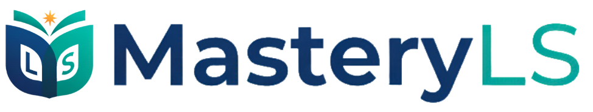

MasteryLS combines GitHub-based course authoring, interactive learning, progress tracking, and optional Canvas and AI services.

## Learn on the web or install the app

MasteryLS works in modern desktop and mobile browsers. It can also be installed as a progressive web app (PWA) from a supported browser. Installation adds an app-style shortcut; offline access depends on the page and files already cached on the device.

| `Install` | `Open` | `Learn` |
| :---: | :---: | :---: |
| 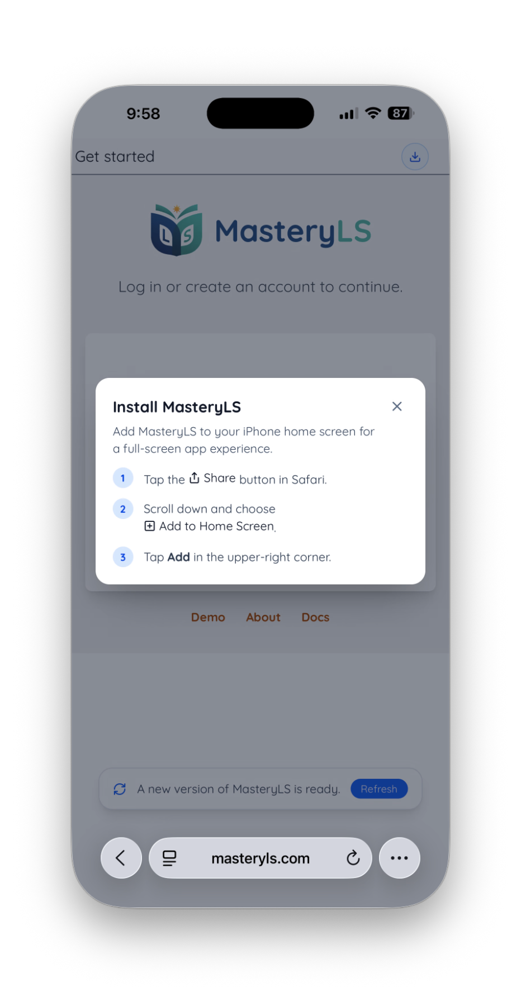 | 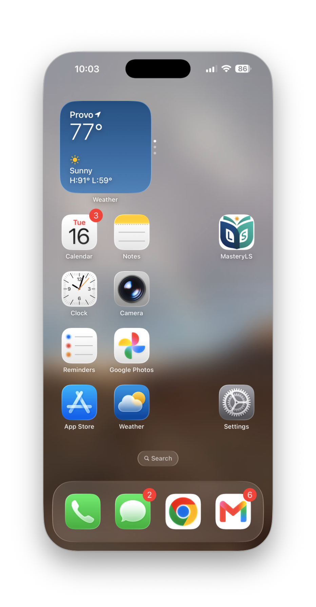 | 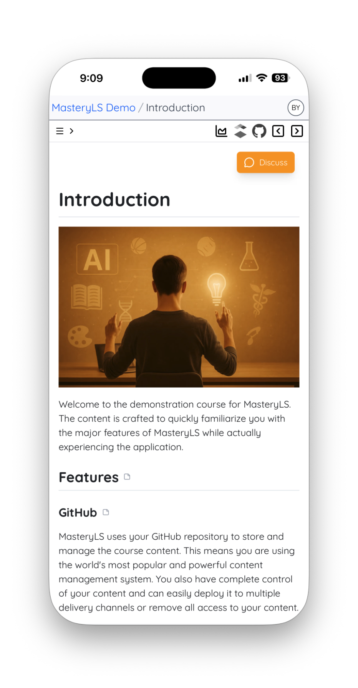 |

## Browse courses and track progress

Public course content may be viewable without signing in. Learners sign in to enroll, submit work, save notes, and keep progress associated with their account. Available sign-in methods depend on the installation; MasteryLS supports email-based one-time-password authentication.

The dashboard shows enrolled courses and progress. When a course has several open sections, a learner chooses a section during enrollment. The section connects the learner to the right schedule and, where enabled, attendance.

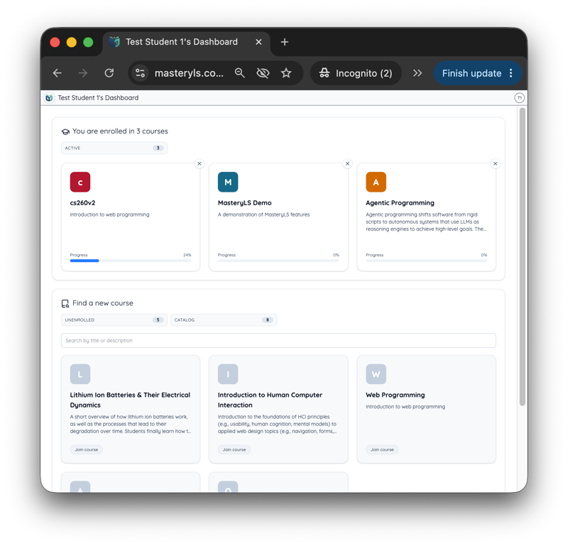

MasteryView summarizes course mastery and lets overseers review a course roster, filter by section, and inspect individual learners. Progress and Metrics provide activity history and time-based views.

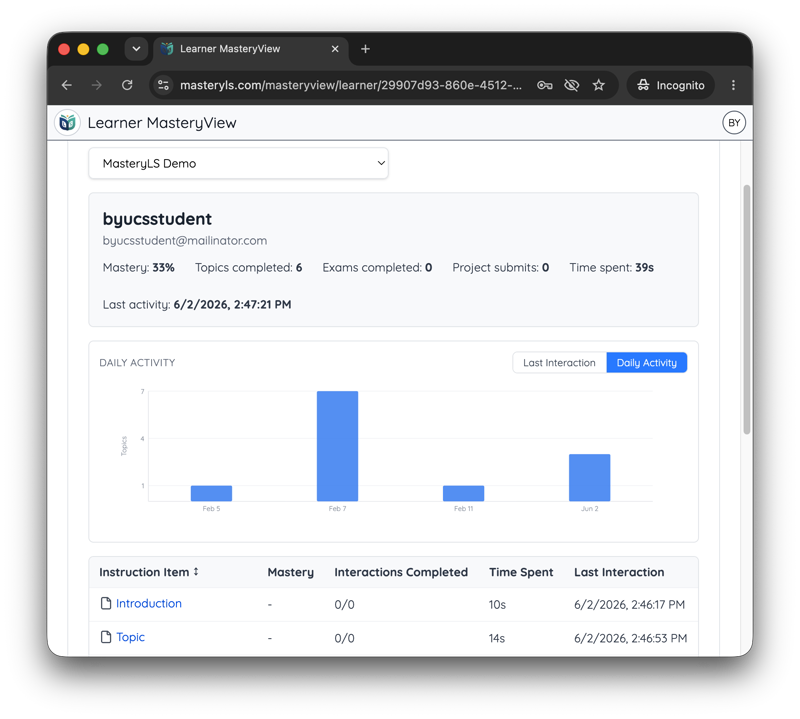

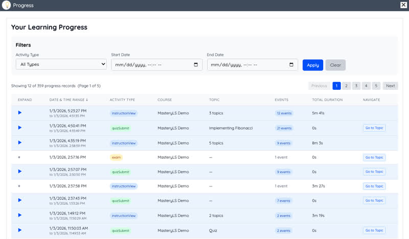

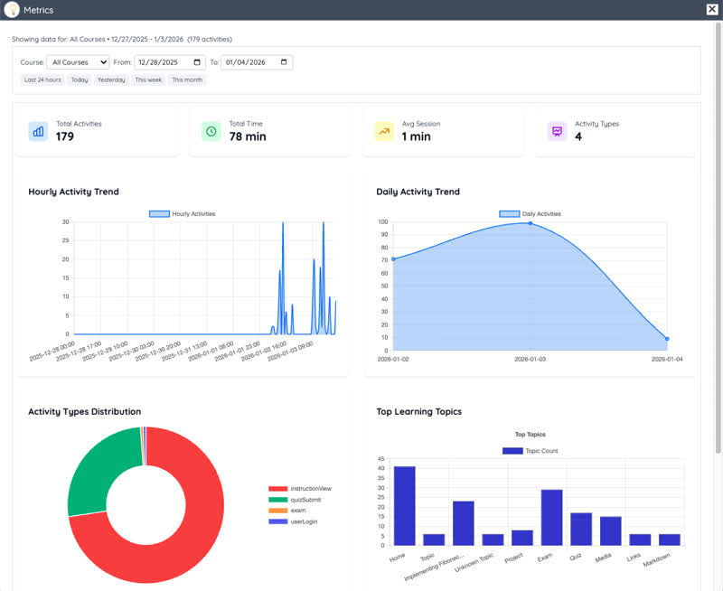

## Course content and interactions

Course structure and Markdown content are stored in GitHub. Topics can include prose, images, video, audio, code, embedded content, and interactive activities. Learners use a topic list and search; level-two headings from the current topic also appear as jump links in the table of contents.

Course authors can use these topic types:

- **Instruction:** Markdown lesson content with embedded interactions.
- **Exam:** a mastery assessment built from the course's interaction and submission workflows.
- **Project:** a deliverable or submission topic that may be reviewed by an instructor.
- **Video** and **Embedded:** media or external content topics.
- **Disciplinary Reasoning Assessment (DRA):** a scenario-based assessment with practice and/or final modes.
- **Interview:** an AI-simulated interview assessment with practice and/or final modes.
- **Schedule:** a course calendar rendered from schedule Markdown.

Embedded interactions include multiple choice, multiple select, essay, survey, Likert, file submission, URL submission, GitHub submission, teaching, prompt, web page, and AI web page. Their scoring and feedback depend on their type and authoring settings; not every interaction is AI-graded. See the [Editor Tutorial](../editorTutorial/editorTutorial.md) and [interaction examples](../example-topic/example-topic.md) for details.

## Terms, schedules, sections, and attendance

Editors organize instruction into terms and sections. Schedules hold the delivery calendar and can be shared by sections. An enrollment's section determines which schedule a learner sees. Editors manage these records in the classroom's **Terms & Sections** view; learners do not see that management view.

Attendance is optional per section. Instructors enable it in Terms & Sections, open a session for a section, and share the session code. Learners in enabled sections can check in and review their attendance history. Instructor views include session response summaries and charts.

## AI support

Depending on course settings and the interaction type, Gemini-powered features can help editors generate or revise course material, help learners discuss a topic, and provide feedback on submissions. Instructors can review learner work and may override or supplement AI feedback. AI features require a configured backend key and should be treated as assistance, with course staff responsible for the instructional decisions.

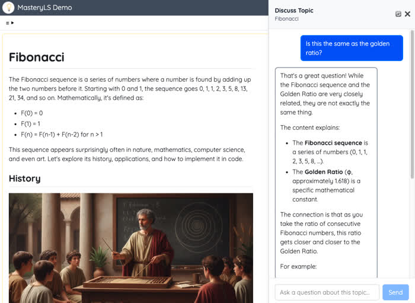

## GitHub authoring and history

Editors can create and revise Markdown-based course material in MasteryLS. Changes are committed to the connected GitHub repository, where the normal Git history, diffs, and collaboration tools remain available. Course and topic publication states control what learners can see.

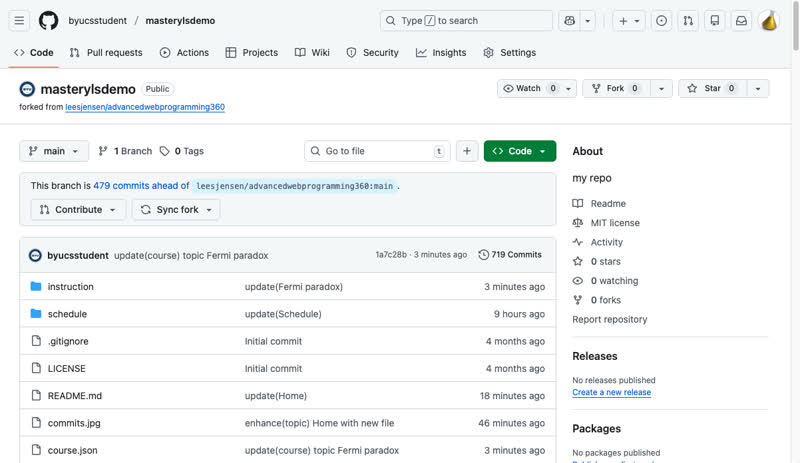

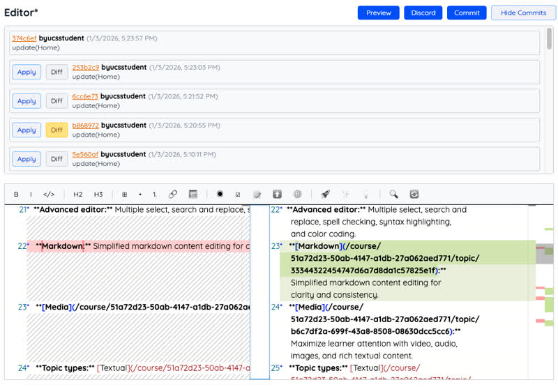

## Canvas integration

An editor can link a MasteryLS course to Canvas to export course content and connect selected topics to Canvas pages, quizzes, or assignments. Depending on course configuration, MasteryLS can also send grades or feedback to Canvas. Some assessment types, such as DRA and Interview, send a suggested score and feedback rather than an automatic authoritative grade.

Overseers can open a Canvas-linked learner's Canvas grades from the learner's MasteryView detail when the learner can be matched to a Canvas account.

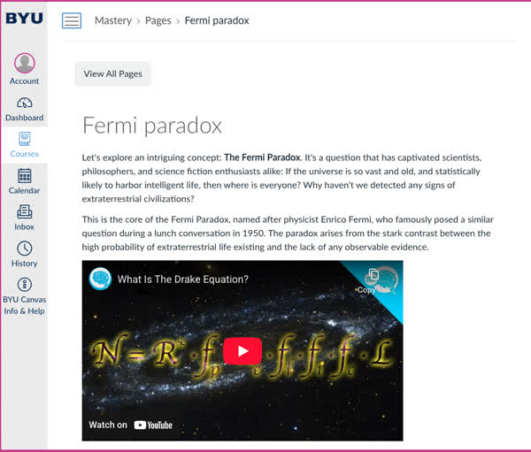

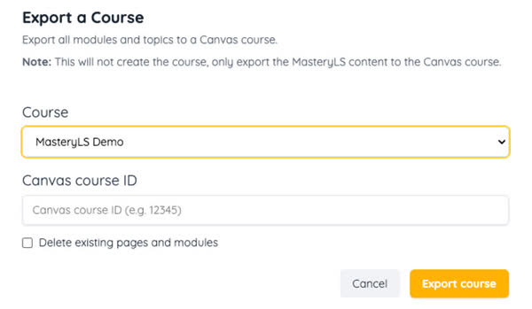
