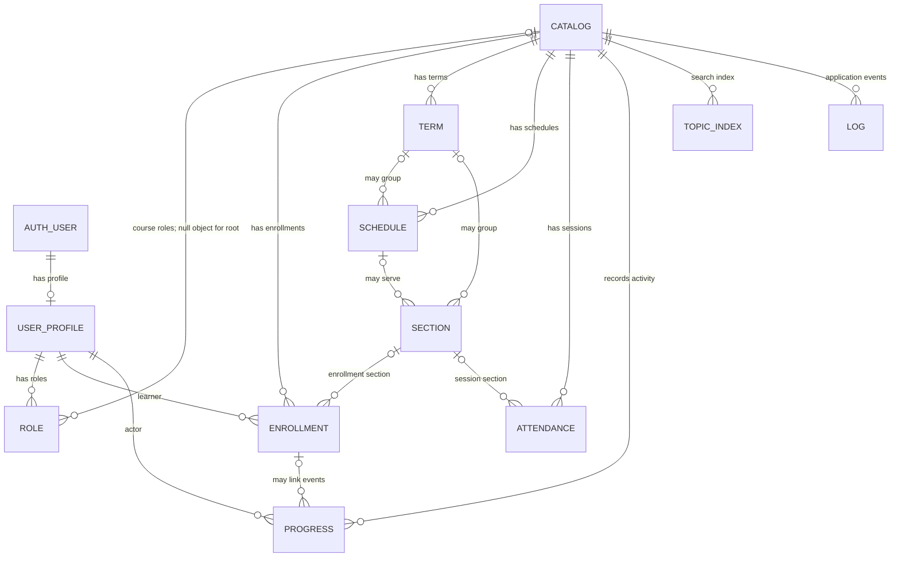

# MasteryLS Database Technology

The current database definition is [install/supabase/schema.sql](../../install/supabase/schema.sql). It defines tables, indexes, triggers, row-level security policies, grants, and RPC functions. Apply schema changes to each Supabase project separately; changing the SQL file does not update a hosted database.

## Main tables and relationships

`AUTH_USER` represents Supabase Auth's `auth.users`; `USER_PROFILE` is the public `user` table. The diagram shows the core relationships. See the SQL for exact column definitions, nullability, foreign keys, indexes, and policies.

| Table | Purpose |
| --- | --- |
| `catalog` | Course listing metadata and GitHub repository reference. |
| `user` | Public profile row associated with Supabase Auth. |
| `role` | Course-scoped editor/mentor grants and global root grants. |
| `enrollment` | Learner-to-course membership, optional `sectionId`, UI settings, and cached progress JSON. |
| `term` | Course-scoped instructional period with optional date bounds. |
| `schedule` | Schedule title, optional term and date range, state, and GitHub `contentPath`. Schedule Markdown is not stored in the database. |
| `section` | Roster group in a term, optional schedule, and `attendanceEnabled` flag. |
| `attendance` | Per-section session, check-in code, questions, open/closed times. Legacy sessions may have a null `sectionId`. |
| `progress` | Append-only activity history, including interaction submissions and attendance check-ins. |
| `topic` | Full-text search index for GitHub course content; not the source of truth for topic Markdown. |
| `log` | Generic append-only application event log. |

## Progress and mastery

Each learner action is recorded as a row in `progress`. `enrollment.progress` is a cached JSON summary used by some operations; it can lag behind the event history. Client-side mastery and completion are derived from the progress history and loaded course structure by `deriveProgressSummary` in `src/utils/progressSummary.js`.

## Terms, schedules, sections, and enrollment

Terms, schedules, and sections are course-scoped records. A section belongs to a term and may use a schedule; multiple sections may share a schedule. An enrollment can have a nullable `sectionId`. When set, that section determines the learner's schedule and whether attendance is available.

New schedules store metadata in `schedule` and keep their Markdown in GitHub at `contentPath`. Legacy courses without DB schedule rows can fall back to `course.json` schedule files. When DB schedule rows exist, they drive schedule resolution.

## Attendance

Attendance is enabled per section. Instructors open a session for a section; learners record a check-in through the `record_attendance` RPC, which verifies the code and writes a progress event of type `attendance` referencing the session. The database permits at most one open session per section and one check-in per enrollment/session. Legacy sessions may remain unattributed with `sectionId = null`.

## Access control and server functions

RLS policies restrict operational data by enrollment and course role. Root and course editors manage course structure; mentors can oversee course learners but do not edit terms or sections. Attendance check-ins and progress writes use RPCs to enforce server-side rules. Privileged Canvas, Gemini, GitHub snapshot, and aggregate operations are implemented in Supabase Edge Functions.
